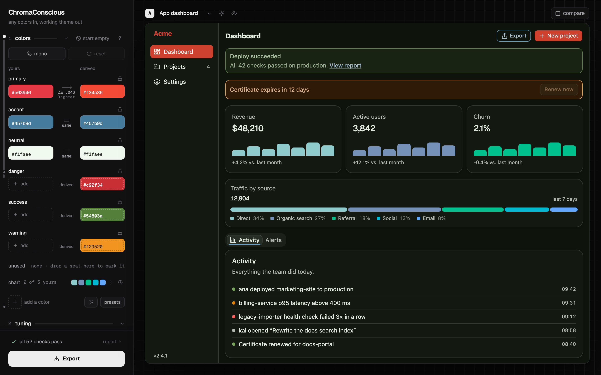
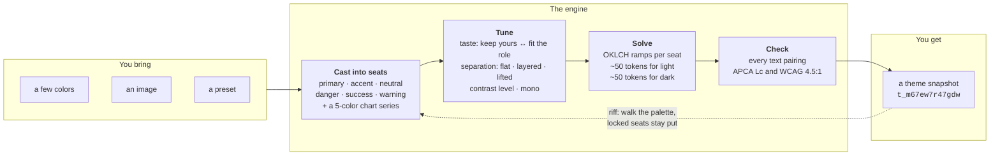
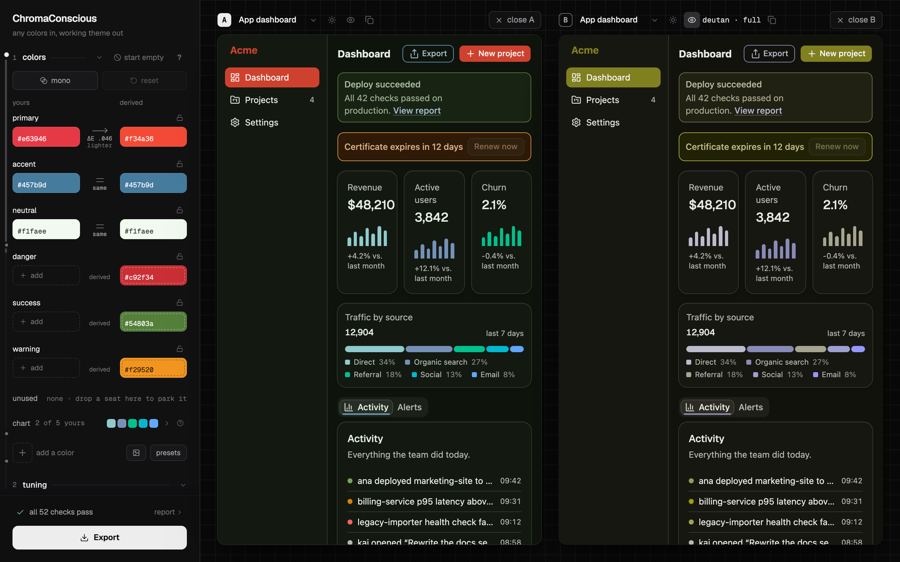
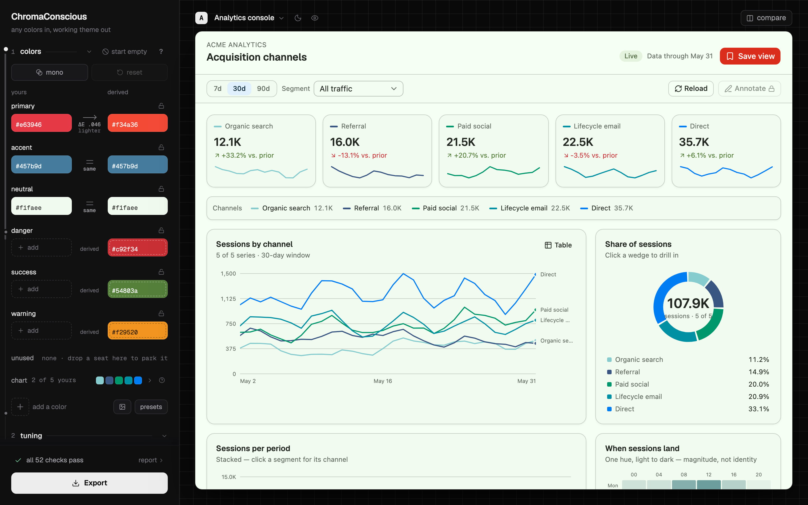
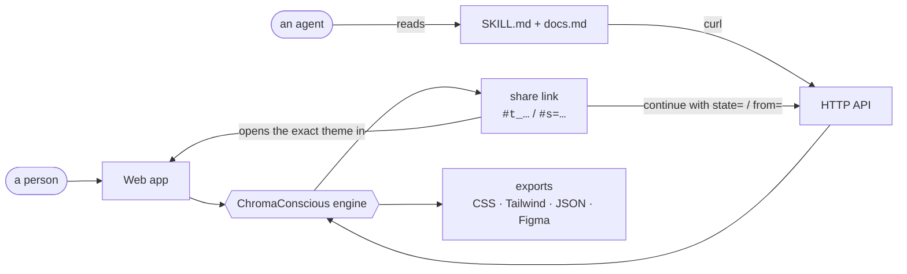

# ChromaConscious

**Any colors in, a working theme out.** Light and dark, contrast-checked, ready to ship as CSS, Tailwind, JSON or Figma variables.

**[Try it →](https://drewkidwell.com/chromaconscious/)** · [API docs](https://drewkidwell.com/chromaconscious/docs.md) · [Agent skill](https://drewkidwell.com/chromaconscious/skill/SKILL.md)



Designing a color palette isn't easy. And you shouldn't need a subscription to get the tools that can help. ChromaConscious is a free and open source alternative to the cornucopia of paywalled color generators and underdeveloped side projects. One of the primary inspirations is [Huemint](https://huemint.com), which is an excellent piece of software that is sadly private and missing some key features.

What ChromaConscious provides:

- Web UI palette generation from starting colors, an image, or a preset
- Colorspace walk, hue & contrast tuning, and shadow options
- Gradient colorblind filters for deuteranopia, protanopia, and tritanopia
- Side-by-side mockup comparisons for humans
- A skill and API documentation made with sightless agents in mind

## How it works

You bring as many or as few colors as you like. The engine casts them into **seats**, the jobs a UI needs colors for, derives whatever is missing, and solves a full token set for light and dark mode. Every text pairing is then checked for contrast.



A few properties make it something you can build on, not just a toy:

- **Your colors are respected, or the change is explained.** By default a color that doesn't suit its role (a primary too close to danger, a chart color too pale to see) is nudged, and the engine says which color moved, why, and how to stop it. At `taste=1` your colors are kept exactly as typed.
- **Riff walks the palette; locks hold it.** Riff steps through nearby palettes from the same inputs. Lock any seat and every later step keeps it exactly.
- **Themes are immutable, deterministic snapshots.** The same inputs always give the same theme, and its ID is a hash of its state. A theme never changes under you: to go back, use the old ID. Share links can also carry the whole theme in the URL (`#s=…`), so they open with no server involved.
- **Every export points back to its theme.** The first line of an exported file is a link that reopens that exact theme, so a repo that ships a ChromaConscious theme also records where it came from.

### See it the way others will

Split the stage to compare two frames side by side: two mockups, two modes, or the same theme seen with and without a colorblind filter. Filters run at any strength, from a partial form (the most common kind) to full dichromacy.



Four mockups (an app dashboard, an analytics console, a marketing page and a brand board) put the theme on real surfaces: status banners, charts, buttons and elevation, in both modes.



## One engine, two ways in

The web app and the API run the same engine with the same verbs (generate, riff, lock, export). A theme can move between a person and an agent in either direction.



The API was designed for agents that can't see the screen. It answers in plain text that says what happened:

```console
$ curl -s "https://drewkidwell.com/api/chromaconscious/v1/generate?preset=coastal-starter"
theme t_m67ew7r47gdw   (riff 0 · taste 0.50 · separation layered · contrast standard)

seats
  primary   #f34a36  yours    from #e63946
  accent    #457b9d  yours
  neutral   #f1faee  yours
  danger    #c92f34  derived
  success   #54803a  derived
  warning   #f29520  derived
chart       #86cccf yours · #385681 yours · #00976d derived · #0090a3 derived · #007df3 derived
adjusted    primary   #e63946 → #f34a36  moved apart from a nearby seat so the two stay tellable apart · taste=1 keeps it as typed

contrast  light 26/26 · dark 26/26   (text ≥ Lc 62 · 4.5:1)

open     https://drewkidwell.com/chromaconscious#t_m67ew7r47gdw
export   https://drewkidwell.com/api/chromaconscious/v1/export?theme=t_m67ew7r47gdw&format=css
```

<sub>Trimmed: the full response also explains the two chart colors it adjusted.</sub>

No key or signup is needed. To give an agent access, point it at the [skill](https://drewkidwell.com/chromaconscious/skill/SKILL.md). The [API reference](https://drewkidwell.com/chromaconscious/docs.md) covers every endpoint and parameter.

## Try it

**[drewkidwell.com/chromaconscious](https://drewkidwell.com/chromaconscious/)**: free, nothing to install. Each [release](https://github.com/DrewGitsIt/chromaconscious/releases) is exactly what's deployed there.

## Contributing

Found a bug or want a feature? **[Open an issue](https://github.com/DrewGitsIt/chromaconscious/issues/new/choose)** first. [CONTRIBUTING.md](CONTRIBUTING.md) explains what makes a good report, how to run the project locally, and how releases work.

```sh
npm ci
npm run dev        # the app at http://localhost:5173
npm test           # unit tests
```

## License

[MIT](LICENSE) © Drew Kidwell
